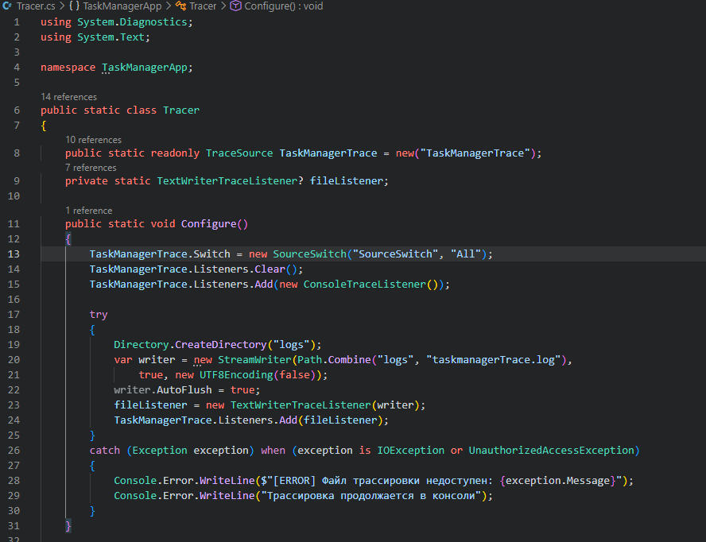
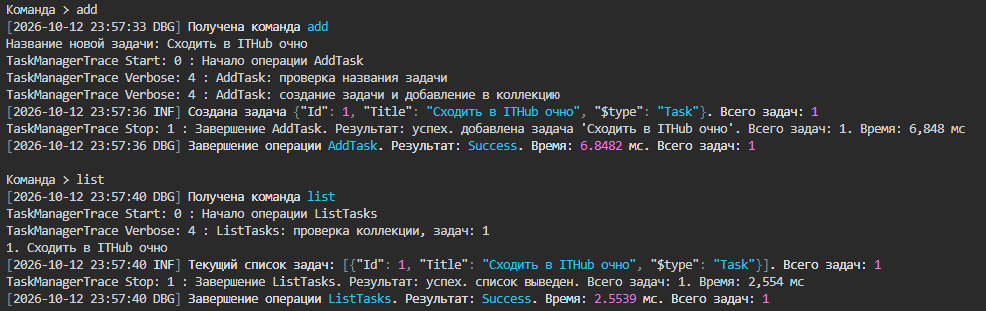
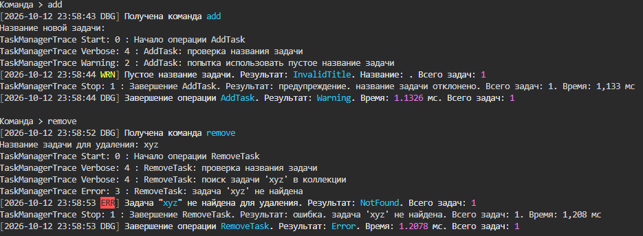
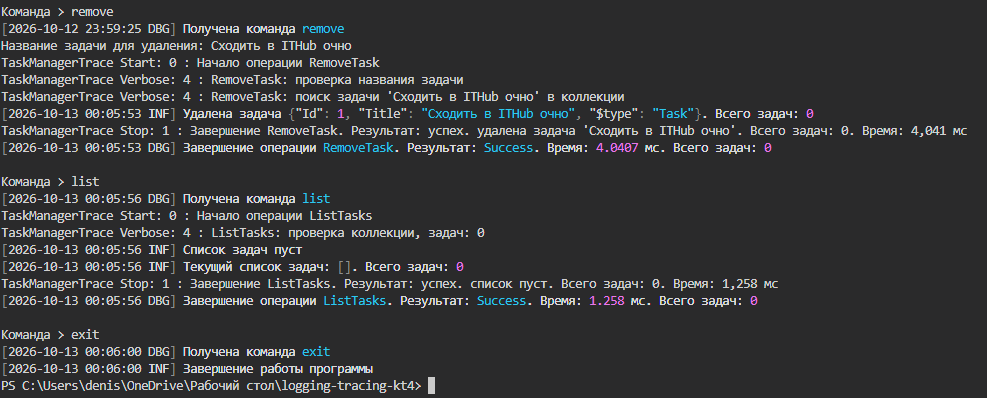
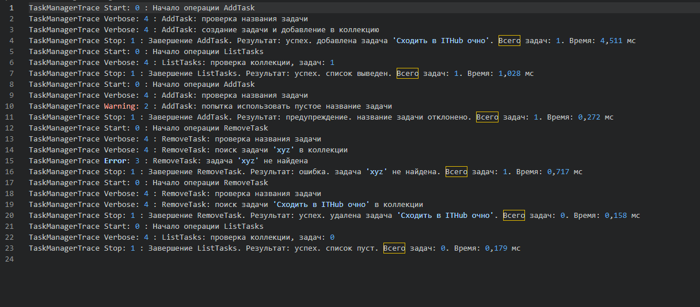

# КТ-4 - Трассировка операций

Студент - Денисенко Даниил Евгеньевич  
Группа - 4п4.23 NET  
Дисциплина - Логирование и трассировка C#  

### Задания

Задание «КТ 4. Трассировка операций»

Наш TaskManager уже умеет:
Добавлять задачу.
Удалять задачу.
Выводить список задач.
(Не является операцией. но все-таки) вести логи.
Теперь добавляем трассировку основных операций (Add, Remove, List), чтобы пошагово фиксировать:
Начало и конец каждой операции.
Время, затраченное на операцию (при необходимости).
Результат (успех/ошибка/предупреждение).
В результате работы прикрепить ссылку на проект и отчет, отражающий результаты.

Шаги

1. Подключить или настроить TraceSource
2. Добавить трассировку в методы (AddTask, RemoveTask, ListTasks):

### Задание 1

Настроил трассировку через TraceSource
Сообщения выводятся в консоль и сохраняются в файл

В коде настроен вывод трассировки в консоль и файл

### Задание 2

Добавил запись начала, конца и результата операций
Stopwatch измеряет время выполнения

Задача «Сходить в ITHub очно» добавлена и показана в списке

Пустое название вызывает предупреждение, задача «xyz» не найдена

Задача удалена, список пуст, программа завершена командой exit

В файле сохранены шаги, результаты и время операций
